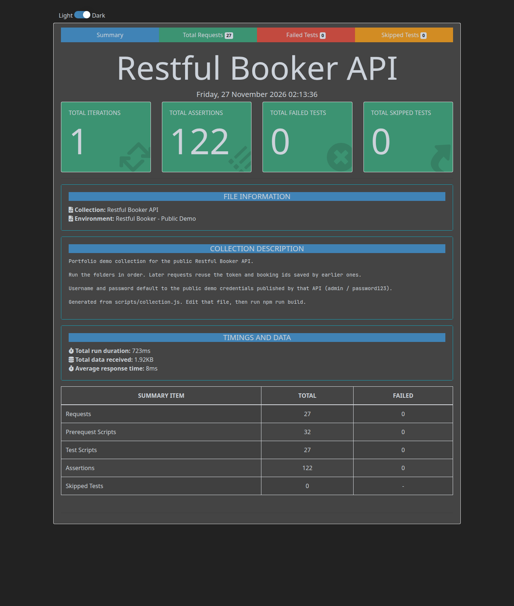

# Restful Booker API tests

[](https://github.com/Potucky/postman-api-collection-newman/actions/workflows/api-tests.yml)

Portfolio project by Vasyl Popovich ([Potucky](https://github.com/Potucky)) for QA Automation, SDET, and Data QA roles.

This is a portfolio demo. It is not code from an employer. It calls the public [Restful Booker](https://restful-booker.herokuapp.com) API and uses only the demo username and password that API publishes (`admin` / `password123`). No private credentials are stored here.

[Live test report](https://potucky.github.io/postman-api-collection-newman/)

## What this project demonstrates

- **API contract and schema checks.** JSON responses are checked with JSON Schema (`additionalProperties: false`), then field by field against the values that same run sent.
- **API functional tests, including negative cases.** A booking is created, read, filtered, replaced, patched, and deleted. Separate requests cover bad credentials, missing and invalid tokens, unknown ids, malformed creates, and writes to an id that was just deleted.
- **CI test reports.** GitHub Actions runs the collection on pull requests and on pushes to `main`, uploads the JUnit file and the htmlextra HTML report, and publishes that HTML report to GitHub Pages from `main`.
- **Chained test data with cleanup.** Each later request reads the token and booking ids saved by the request before it. Names are unique per run, and the suite deletes every booking it creates.
- **Collection as code.** The Postman collection is generated from `scripts/collection.js`. CI rejects a committed JSON file that does not match the generator.

## What this demonstrates

- A Postman collection you can import and run in the Collection Runner, with the same file Newman runs in CI.
- An auth token flow: `POST /auth`, save the token, and send it as `Cookie: token=...` on later writes.
- A chained booking lifecycle. Each step reads the id and payload saved by the step before it: create, read, filter, full replace, read, partial update, read, delete, read.
- JSON Schema checks through `pm.response.to.have.jsonSchema`, plus field assertions against the values that same run sent.
- Negative cases: bad password, non-JSON login, missing and invalid tokens, unknown ids, malformed creates, and writes to an id that was just deleted.
- A characterization of a real gap on the demo: a stay whose checkout is before checkin is accepted.
- Newman in GitHub Actions, with a JUnit file and an [htmlextra](https://github.com/DannyDainton/newman-reporter-htmlextra) HTML report uploaded as an artifact.
- Configuration in a Postman environment file, with optional shell overrides. Dependencies are pinned in `package.json` and `package-lock.json`.

## Tech stack

| Piece | Choice |
| --- | --- |
| Collection | Postman Collection v2.1 |
| Runner | Newman 6.2.3 |
| HTML report | newman-reporter-htmlextra 1.23.1 |
| Schema assertions | Ajv, via the Postman sandbox `jsonSchema` assertion |
| Runtime | Node.js 22 (see `.nvmrc`) |
| CI | GitHub Actions |

## Project structure

```text
.
├── .github/workflows/api-tests.yml          # install, drift check, Newman, upload report
├── .github/workflows/pages.yml              # on main: Newman, then GitHub Pages
├── collections/
│   └── restful-booker.postman_collection.json   # file you import into Postman
├── environments/
│   └── restful-booker.postman_environment.json  # base URL and demo credentials
├── schemas/                                 # JSON Schemas embedded into the collection
├── scripts/
│   ├── collection.js                        # source for the collection
│   ├── build-collection.js                  # writes the JSON and syntax-checks scripts
│   └── run-newman.js                        # CLI run, reporters, env overrides
├── docs/sample-newman-report.png            # summary from a local run
├── package.json
└── package-lock.json
```

`reports/` is created locally and in CI. It is gitignored. A run writes `reports/newman-report.html` and `reports/junit.xml`.

## API under test

[Restful Booker](https://restful-booker.herokuapp.com) is a public booking demo. [API docs](https://restful-booker.herokuapp.com/apidoc/index.html).

| | |
| --- | --- |
| Base URL | `https://restful-booker.herokuapp.com` |
| Demo user | `admin` |
| Demo password | `password123` |

Those credentials are the ones the demo documents. They are in the environment file so the collection runs immediately after import. Treat them as public sample data.

Writes that change or delete a booking send the token from `POST /auth` as a cookie. Creating a booking does not require a token. The collection deletes every booking it creates.

## Run it in Postman

1. Import `collections/restful-booker.postman_collection.json`.
2. Import `environments/restful-booker.postman_environment.json`.
3. Select the environment **Restful Booker - Public Demo**.
4. Open the collection and choose **Run**.
5. Leave the delay at 0 ms and leave the data file empty. Run all four folders in order.

The folders are ordered on purpose. Later requests read `token` and booking ids saved by earlier ones. Running a single request from the middle of the lifecycle fails its chain check and tells you which request to run first.

## Run it from the command line

```bash
npm ci
npm test
```

`npm test` rebuilds the collection from `scripts/collection.js`, then runs Newman. Open `reports/newman-report.html` for the HTML report. `reports/junit.xml` is the JUnit file (27 tests, one per request, 122 assertions on the last local run).

The same command Newman is given in CI:

```bash
npx newman run collections/restful-booker.postman_collection.json \
  -e environments/restful-booker.postman_environment.json \
  --timeout-request 30000 \
  -r cli,junit,htmlextra \
  --reporter-junit-export reports/junit.xml \
  --reporter-htmlextra-export reports/newman-report.html
```

## Configuration

The environment file holds the only settings a run needs. `scripts/run-newman.js` overrides them when these variables are set:

| Environment value | Shell override |
| --- | --- |
| `baseUrl` | `BASE_URL` |
| `username` | `BOOKER_USERNAME` |
| `password` | `BOOKER_PASSWORD` |

```bash
BASE_URL=https://restful-booker.herokuapp.com npm test
```

Request timeout is 30 seconds. There is no pause between requests. Names are unique per run (`Port` plus a timestamp suffix), so two people hitting the shared demo do not collide, and the suite does not depend on a hard-coded booking id.

The HTML report skips `Cookie` and `Authorization` headers and hides the auth request and token response bodies.

## Continuous integration

[`.github/workflows/api-tests.yml`](.github/workflows/api-tests.yml) runs on pull requests, on pushes to `main`, and from the Actions tab (`workflow_dispatch`).

1. `npm ci` from the lockfile.
2. `npm run build`, then `git diff --exit-code` on the collection, so a hand-edit of the JSON cannot drift from `scripts/collection.js`.
3. `npm run test:run` (Newman).
4. Upload `reports/newman-report.html` and `reports/junit.xml` as the artifact **newman-report** (kept 14 days), including when the run fails.

[`.github/workflows/pages.yml`](.github/workflows/pages.yml) runs on pushes to `main`. It repeats that install, drift check, and Newman run, then publishes the HTML report with `actions/upload-pages-artifact` and `actions/deploy-pages`. The [Live test report](https://potucky.github.io/postman-api-collection-newman/) is an index page that links to `newman-report.html`. The repository Pages source has to be **GitHub Actions** before that address serves a report. The workflow does not change that setting.

## Sample output

Local `npm test` against the public demo. 27 requests, 122 assertions, 0 failures, about 0.7 seconds.

```text
↳ Create booking
  POST https://restful-booker.herokuapp.com/booking [200 OK, 950B, 7ms]
  ✓  status is 200
  ✓  content type is JSON
  ✓  body matches the created-booking schema
  ✓  booking id is saved for chained requests
  ✓  created booking echoes the request and drops clientRef

↳ Confirm authz booking unchanged
  GET https://restful-booker.herokuapp.com/booking/1386 [200 OK, 929B, 6ms]
  ✓  negativeBookingId was chained from an earlier request
  ✓  status is 200
  ✓  content type is JSON
  ✓  body matches the booking schema
  ✓  forbidden writes left the stored booking unchanged

┌─────────────────────────┬──────────────────┬─────────────────┐
│                         │         executed │          failed │
├─────────────────────────┼──────────────────┼─────────────────┤
│              iterations │                1 │               0 │
│                requests │               27 │               0 │
│            test-scripts │               27 │               0 │
│      prerequest-scripts │               32 │               0 │
│              assertions │              122 │               0 │
├─────────────────────────┴──────────────────┴─────────────────┤
│ total run duration: 723ms                                    │
│ average response time: 8ms [min: 5ms, max: 64ms, s.d.: 10ms] │
└──────────────────────────────────────────────────────────────┘
```

The 32 pre-request scripts are the collection script (it runs before every request and loads the schemas) plus the five requests that set a payload.



## Test approach

Requests run top to bottom. Pre-request scripts set the booking fields for that call. Test scripts save `token`, `bookingId`, `edgeBookingId`, and `negativeBookingId` on the collection. The next request reads them back. Nothing sleeps, and nothing asserts a tight response-time budget: the demo is a shared public host, so a latency gate would be flaky.

Schemas in `schemas/` are the contract. `scripts/build-collection.js` embeds them into the collection pre-request, and each JSON response calls `pm.response.to.have.jsonSchema`. `additionalProperties` is false, so an unexpected field fails the run. Field checks then compare the body to the values this run actually sent, including the boolean and integer fields that travel through collection variables as strings.

Writes include a `clientRef` property the API does not document. The schema and an explicit assertion both require that the property is not stored.

Search asserts two things: the new id is in `GET /booking?firstname&lastname`, and the filter returned fewer than five rows. A broken filter that dumped every booking on the demo would fail the size check.

Negative requests assert the status codes and plain-text bodies the demo returns today, including the ones that differ from a typical REST API. That keeps the suite honest about this host. The inverted-date request is the one characterization test: checkout before checkin is accepted and echoed, and the booking is deleted immediately afterward. If the demo starts rejecting that payload, this assertion is the one to update.

## Coverage

| Area | Call | What is checked |
| --- | --- | --- |
| Health | `GET /ping` | 201, plain text `Created` |
| Auth | `POST /auth` | Token schema, token saved |
| Bad password | `POST /auth` | 200, `{reason: "Bad credentials"}`, saved token unchanged |
| Non-JSON login | `POST /auth` with `Content-Type: text/plain` | Same error shape, saved token unchanged |
| Create | `POST /booking` | Created-booking schema, id saved, echo, `clientRef` dropped |
| Read | `GET /booking/:id` | Booking schema and persisted fields |
| Search | `GET /booking?firstname&lastname` | Id-list schema, this id present, small result |
| Replace | `PUT /booking/:id` | Full echo, then a GET confirms it was stored |
| Partial update | `PATCH /booking/:id` | Only `additionalneeds` changes, then a GET confirms it |
| Delete | `DELETE /booking/:id` | 201 `Created`, then GET is 404 |
| No token | `PUT` and `DELETE` | 403 `Forbidden` |
| Bad token | `PUT` with `token=invalid-token` | 403 `Forbidden` |
| After the 403s | `GET /booking/:id` | Stored booking is still the one that was created |
| Unknown id | `GET /booking/999999999` | 404 `Not Found` |
| Empty body | `POST /booking` `{}` | 500 `Internal Server Error` |
| Missing firstname | `POST /booking` | 500 `Internal Server Error` |
| Inverted stay | `POST /booking` | Accepted and echoed, then deleted |
| Deleted id | `PUT` and `DELETE` | 405 `Method Not Allowed` |

Out of this suite, on purpose:

- HTTP Basic as a second way to authorize a write. The demo accepts it. This collection uses the cookie token so there is one chain to follow.
- A response-time gate.
- XML content negotiation.
- Two runs racing to update the same booking id.

## Behavior of the public demo

These are the responses the collection asserts. They match the demo as it behaves now.

| Situation | Response |
| --- | --- |
| Valid login | 200 and `{ "token": "..." }` |
| Bad login, or a login that is not `application/json` | 200 and `{ "reason": "Bad credentials" }` |
| Create / read / replace / patch | 200 and a JSON booking |
| Delete | 201 and the plain text `Created` |
| Write with no token or a bad token | 403 and the plain text `Forbidden` |
| Read of a missing id | 404 and the plain text `Not Found` |
| Replace or delete of a missing id | 405 and the plain text `Method Not Allowed` |
| Create with an empty object or no firstname | 500 and the plain text `Internal Server Error` |
| Unknown field such as `clientRef` | Dropped. It is not in the stored booking |
| Checkout earlier than checkin | Accepted |

A cold start on the public host can make the first call slower. The client waits up to 30 seconds. If the demo is down, CI goes red, because the suite is aimed at that host.

## Changing the tests

Edit `scripts/collection.js` or the files in `schemas/`, then run `npm run build`. That rewrites `collections/restful-booker.postman_collection.json`. Commit both. CI rejects a collection JSON that does not match the generator.

## Author

Vasyl Popovich, QA Automation Engineer, Miami, FL. GitHub: https://github.com/Potucky
